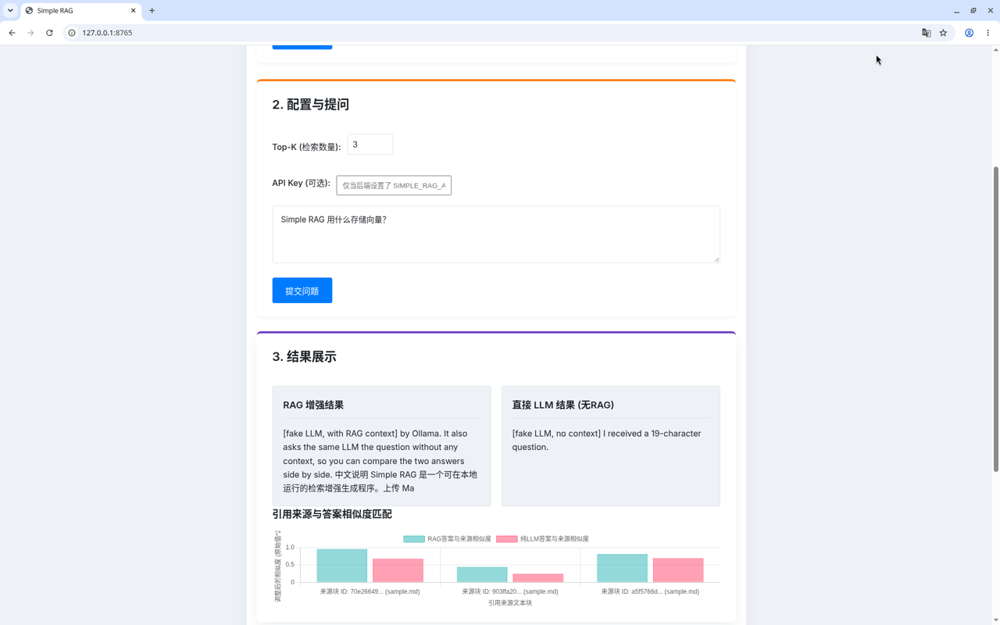
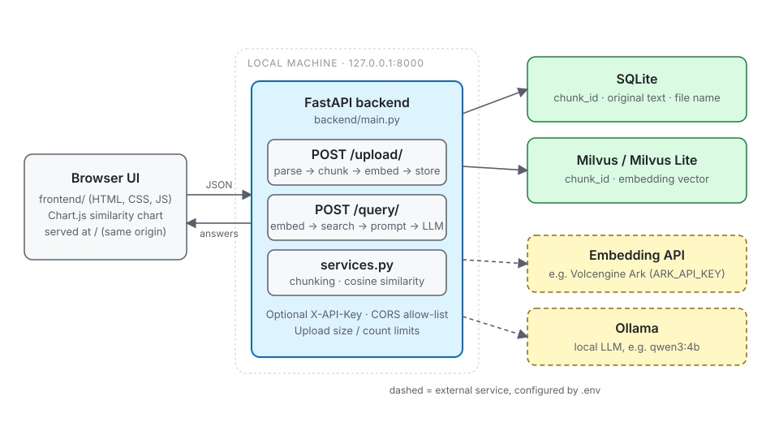
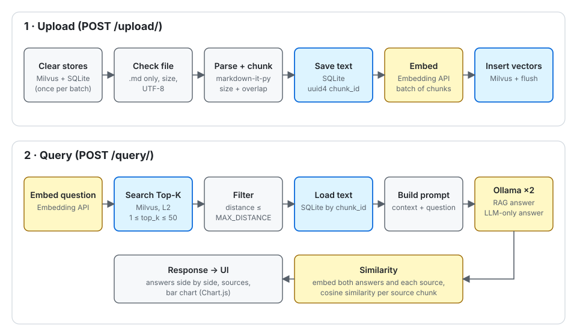

# Simple RAG

**English** | [简体中文](README.zh-CN.md)

A small Retrieval-Augmented Generation (RAG) app that runs on your own machine.
Upload Markdown files, ask a question, and see two answers side by side: one from a local LLM
that gets the retrieved document chunks as context, and one from the same LLM without any context.
A bar chart shows how close each answer is to each source chunk.

- **Backend:** Python, FastAPI, SQLite (SQLAlchemy), Milvus (pymilvus), Ollama, any `/embeddings` API
- **Frontend:** plain HTML, CSS and JavaScript, Chart.js
- **License:** [MIT](LICENSE)



*The UI running against the offline fake services (`scripts/fake_services.py`), so the answers are canned.*

## Table of contents

- [Features](#features)
- [How it works](#how-it-works)
  - [Architecture](#architecture)
  - [Startup](#startup)
  - [Upload: parsing and chunking](#upload-parsing-and-chunking)
  - [Embeddings](#embeddings)
  - [Storage: SQLite and Milvus](#storage-sqlite-and-milvus)
  - [Retrieval](#retrieval)
  - [Generation](#generation)
  - [Similarity comparison](#similarity-comparison)
  - [Requests per operation](#requests-per-operation)
- [Quick start](#quick-start)
- [Offline demo with the fake services](#offline-demo-with-the-fake-services)
- [Using the web UI](#using-the-web-ui)
- [Configuration](#configuration)
- [API](#api)
  - [Authentication, CORS and limits](#authentication-cors-and-limits)
  - [POST /upload/](#post-upload)
  - [POST /query/](#post-query)
  - [GET /health](#get-health)
  - [Web UI and OpenAPI docs](#web-ui-and-openapi-docs)
  - [Error codes](#error-codes)
- [Development and testing](#development-and-testing)
- [Project layout](#project-layout)
- [Deployment and security](#deployment-and-security)
- [Known limitations](#known-limitations)
- [FAQ](#faq)
- [Contributing](#contributing)
- [License](#license)

## Features

- Upload one or more `.md` files from the browser or with `curl`. Text is extracted with `markdown-it-py`
  and split into fixed-size character chunks with overlap (`CHUNK_SIZE`, `CHUNK_OVERLAP`).
- Each chunk gets a UUID. Its text and file name go to SQLite; its vector goes to Milvus (a server or a
  local Milvus Lite file).
- Embeddings come from an HTTP embedding API. The default is Volcengine Ark
  (`doubao-embedding-text-240715`, 2560 dimensions); any endpoint that accepts the same request and returns
  the same response shape works (see [Embeddings](#embeddings)).
- A question is embedded, the Top-K closest chunks are fetched from Milvus (L2 distance by default),
  chunks farther than `MILVUS_SEARCH_MAX_DISTANCE` are dropped, and the rest become the prompt context.
- The LLM runs in Ollama (default `qwen3:4b`). `<think>…</think>` blocks are removed from answers.
- Every query returns two answers: one with the retrieved context (RAG) and one from the bare question
  (LLM-only), plus the source chunks and the cosine similarity between each answer and each source chunk.
- Every upload **replaces** the previous index, so SQLite and Milvus describe the same batch
  (see [Known limitations](#known-limitations) for the edge cases).
- Safe defaults: listens on `127.0.0.1`, refuses to start on a public address without an API key,
  CORS allow-list, upload size and count limits.
- A fake embedding API and fake Ollama (`scripts/fake_services.py`) let you run the whole pipeline and the
  test suite offline, without keys or models.

## How it works

### Architecture



The backend is one FastAPI app (`backend/main.py`). It serves the web UI from `frontend/` on the same
origin, so the browser needs no CORS entry. `backend/services.py` holds the chunking, Markdown parsing,
embedding, Milvus, Ollama and cosine-similarity code; `backend/crud.py` and `backend/database.py` hold the
SQLite table.



### Startup

Everything below happens when `backend.main` is imported, before the server accepts requests:

1. `backend/config.py` reads the environment and a `.env` file (see [Configuration](#configuration)).
   If `ARK_API_KEY` is empty, the import fails with `ValueError: ARK_API_KEY is not set in the environment variables.`
2. The SQLite table `chunks` is created if it does not exist.
3. The app connects to Milvus and loads the collection, or creates it (schema and index) if it does not
   exist. A failure here is only logged; the server still starts and Milvus errors show up on the first request.
4. The app asks Ollama for its model list once. If Ollama is unreachable it logs a warning and continues.
5. In the app lifespan, the **bind check** runs: the server refuses to start on a non-loopback address
   without `SIMPLE_RAG_API_KEY` (details in [Deployment and security](#deployment-and-security)).

### Upload: parsing and chunking

`POST /upload/` handles a batch of files in this order:

1. If the API key is enabled, the `X-API-Key` header is checked. More than `MAX_UPLOAD_FILES` files is
   rejected with `413` before anything is changed.
2. **The index is cleared once per batch.** The Milvus collection is dropped first. Only if that succeeds
   are all rows deleted from the SQLite `chunks` table. If Milvus cannot be cleared, the request fails with
   `500` and SQLite is left as it was.
3. Then each file is processed on its own. A problem with one file is reported in that file's result and the
   next file is processed:
   - The file name is reduced to its base name (directory parts separated by `/` or `\` are dropped),
     trimmed and cut to 255 characters; an empty name becomes `unnamed.md`. Files are never written to disk.
   - Only names ending in `.md` (case-insensitive) are accepted; others are skipped.
   - At most `MAX_UPLOAD_FILE_BYTES + 1` bytes are read; a larger file is skipped.
   - The bytes are decoded as UTF-8. Other encodings fail for that file.
   - `markdown-it-py` parses the Markdown. The raw content of every `inline` token (headings, paragraphs,
     list items; inline markup such as `**bold**` stays in the text) and of every fenced code block is
     kept, and the parts are joined with newlines.
   - The text is cut into chunks of `CHUNK_SIZE` characters. Each chunk starts
     `CHUNK_SIZE - CHUNK_OVERLAP` characters after the previous one, so neighbours share `CHUNK_OVERLAP`
     characters. With the defaults (200/50) a chunk starts every 150 characters. Chunks are cut by
     character count, not at word, sentence or heading boundaries.
   - Each chunk is saved to SQLite with a new UUID4 `chunk_id`, then all chunks of the file are embedded in
     one request, then the vectors are inserted into Milvus and flushed.

### Embeddings

`services.get_embeddings()` sends one `POST` to `EMBEDDING_API_URL`:

```http
Authorization: Bearer <ARK_API_KEY>
Content-Type: application/json

{"model": "<EMBEDDING_MODEL_NAME>", "input": ["text 1", "text 2"], "encoding_format": "float"}
```

It expects `{"data": [{"embedding": [0.1, ...]}, ...]}`, one item per input, in order. The request times
out after `EMBEDDING_TIMEOUT_SECONDS`. Network errors, HTTP errors and a malformed response are raised as
`ValueError`. If the vector length differs from `MILVUS_DIMENSION`, only a warning is logged; the Milvus
insert or search then fails. `ARK_API_KEY` is only sent to `EMBEDDING_API_URL` and is never logged.

### Storage: SQLite and Milvus

The two stores are linked by `chunk_id`:

| Store | What is stored | Schema |
| --- | --- | --- |
| SQLite (`SQLITE_DATABASE_URL`) | chunk text and file name | table `chunks`: `chunk_id` (string, primary key), `original_content` (text), `source_document_name` (string), `upload_timestamp` (UTC) |
| Milvus (`MILVUS_COLLECTION_NAME`) | the vector only | `chunk_id` (`VARCHAR(36)`, primary key, name from `MILVUS_ID_FIELD_NAME`), `embedding` (`FLOAT_VECTOR` with `MILVUS_DIMENSION` dimensions, name from `MILVUS_VECTOR_FIELD_NAME`) |

When the collection is created, an index is built on the vector field with `MILVUS_INDEX_TYPE`,
`MILVUS_METRIC_TYPE` and `nlist = MILVUS_INDEX_PARAM_NLIST`, and the collection is loaded. The collection
is created at startup if it is missing, and again on the first insert after an upload dropped it, so changes
to the schema or index settings take effect after the next upload.

Set `MILVUS_CONNECTION_URI` to connect by URI: a server URI such as `http://localhost:19530`, or a file path
such as `./milvus_lite.db` for Milvus Lite (`pip install milvus-lite`). When it is empty, `MILVUS_HOST` and
`MILVUS_PORT` are used.

### Retrieval

`POST /query/` embeds the question and searches the vector field with `metric_type = MILVUS_METRIC_TYPE`,
`nprobe = MILVUS_SEARCH_PARAM_NPROBE`, `limit = top_k` and `consistency_level = MILVUS_CONSISTENCY_LEVEL`.
Every hit with `distance > MILVUS_SEARCH_MAX_DISTANCE` is dropped. This filter keeps *small* distances,
which fits the default `L2` metric (smaller is closer). The default threshold `10000.0` is very large, so in
practice it filters almost nothing; lower it to drop weak matches. The remaining `chunk_id`s are looked up
in SQLite to get the text and file name.

### Generation

The context is the text of the retrieved chunks joined with `\n\n---\n\n`. The RAG prompt is a fixed
Chinese template (`backend/main.py`):

```text
以下是相关背景信息：

<context>

---
基于以上信息，请回答问题：<question>
```

("Here is the relevant background information: … Based on the information above, answer the question: …")
If no chunk passes the filter, `<context>` is `没有在文档中找到相关信息。` ("No relevant information was
found in the documents.") and the RAG prompt is still sent. The LLM-only prompt is the question itself.
Both prompts go to Ollama's chat API (`ollama.Client(host=OLLAMA_BASE_URL).chat`) as a single user message
for `LLM_MODEL_NAME`, without streaming. `<think>…</think>` blocks are removed and the answer is trimmed.

### Similarity comparison

When at least one source chunk was found, the backend embeds the RAG answer, the LLM-only answer and the
text of each source chunk (chunk vectors are computed again, not read from Milvus), and computes the cosine
similarity of each answer with each chunk:

```text
cos(a, b) = (a · b) / (‖a‖ · ‖b‖)
```

The value is `0.0` when a vector is empty, the lengths differ, or a vector is all zeros. The result is
`similarity_scores`: one entry per source chunk with `similarity_with_rag_answer` and
`similarity_with_llm_only_answer`. If there are no sources or an answer is empty, `similarity_scores` is
`null`. The web UI plots the **square** of each value (`frontend/script.js`, `exponent = 2`) to make the
difference easier to see; the API returns the raw cosine.

### Requests per operation

| Operation | Embedding API requests | Ollama requests |
| --- | --- | --- |
| Upload | 1 per accepted, non-empty file (all chunks of the file in one request) | 0 |
| Query with N sources | 1 (question) + 2 (answers) + N (one per source chunk) | 2 |
| Query without sources | 1 | 2 |

## Quick start

### Requirements

- Python 3.9 or newer (`pyproject.toml`; CI runs 3.10 and 3.12)
- For real answers:
  - a running [Milvus](https://milvus.io/docs/install_standalone-docker.md) server, or Milvus Lite
    (`pip install milvus-lite`);
  - [Ollama](https://ollama.com/download) with a pulled model;
  - an embedding API key (Volcengine Ark by default).
- No key and no model are needed for the [offline demo](#offline-demo-with-the-fake-services) and the tests.

### 1. Install

```bash
git clone https://github.com/PakhomLeo/Simple-RAG.git
cd Simple-RAG
python -m venv .venv
source .venv/bin/activate          # Windows: .venv\Scripts\activate
pip install -r requirements.txt
```

### 2. Configure

```bash
cp .env.example .env
ollama pull qwen3:4b
```

Edit `.env`. At minimum set `ARK_API_KEY`, and check `MILVUS_HOST`/`MILVUS_PORT` (or
`MILVUS_CONNECTION_URI`), `OLLAMA_BASE_URL`, `LLM_MODEL_NAME` and `MILVUS_DIMENSION` (it must match the
embedding size). To use Milvus Lite instead of a server, `pip install milvus-lite` and set
`MILVUS_CONNECTION_URI=./milvus_lite.db`.

### 3. Run

From the project root:

```bash
python -m backend.main
# or: uvicorn backend.main:app --host 127.0.0.1 --port 8000
```

`python -m backend.main` listens on `FASTAPI_HOST:FASTAPI_PORT` (default `127.0.0.1:8000`) with auto-reload
on. **With Milvus Lite, use the `uvicorn` command** (see [Known limitations](#known-limitations)). Open <http://127.0.0.1:8000/>. The interactive API docs are at <http://127.0.0.1:8000/docs>.

> **Always open the UI through the backend at `/`.** Opening `frontend/index.html` directly from disk
> (`file://`) is not supported: the browser blocks the API calls.

### 4. Try it

Upload `examples/sample.md` (English) or `examples/sample.zh-CN.md` (Chinese) and ask one of the questions
listed at the end of each file.

## Offline demo with the fake services

`scripts/fake_services.py` is one small HTTP server that plays both the embedding API and Ollama:

- `POST …/embeddings` returns deterministic bag-of-characters vectors (each non-space character is hashed
  into one of `--dim` buckets, then the vector is normalised), so texts that share characters are close.
- `POST /api/chat` answers `[fake LLM, with RAG context] <first 160 characters of the context>` for a RAG
  prompt and `[fake LLM, no context] I received a N-character question.` otherwise.
- `GET /api/tags` lists one model, so the startup check of Ollama succeeds.

It needs no key and no model, and is for demos and tests only.

```bash
pip install -r requirements-dev.txt        # adds milvus-lite, pytest, httpx, ruff
python scripts/fake_services.py --port 18080 --dim 64 &

export ARK_API_KEY=placeholder              # must be non-empty; the fake API ignores it
export EMBEDDING_API_URL=http://127.0.0.1:18080/api/v3/embeddings
export OLLAMA_BASE_URL=http://127.0.0.1:18080
export MILVUS_CONNECTION_URI=./milvus_lite.db
export MILVUS_DIMENSION=64                  # must match --dim
uvicorn backend.main:app --host 127.0.0.1 --port 8000   # not python -m backend.main with Milvus Lite
```

Then open <http://127.0.0.1:8000/>, upload `examples/sample.md` or `examples/sample.zh-CN.md` and ask a
question, or use the `curl` examples in [API](#api). The screenshot at the top was taken this way.
Stop both processes when you are done (`Ctrl+C` for the backend, `kill %1` for the fake server). The demo
creates `milvus_lite.db` and `rag_sqlite.db` in the working directory; git ignores both.

Options of the fake server: `--host` (default `127.0.0.1`), `--port` (default `18080`), `--dim` (default `64`).

## Using the web UI

The page (`frontend/index.html`, Chinese labels) has four parts:

1. **Upload Markdown documents** – pick one or more `.md` files and click upload. Each file's result
   (number of chunks, or why it was skipped) is listed. Each upload replaces the index.
2. **Configure and ask** – Top-K (1–10 in the form; the API allows up to `MAX_TOP_K`), an optional API key
   field (only needed when the backend sets `SIMPLE_RAG_API_KEY`; it is kept in `sessionStorage` for the
   tab), and the question.
3. **Results** – the RAG answer and the LLM-only answer side by side, and the similarity bar chart
   (squared cosine, one pair of bars per source chunk, labelled with the first 8 characters of the
   `chunk_id` and the file name).
4. **Source details** – the file name, `chunk_id` and full text of each source chunk.

All text from the server is HTML-escaped before it is shown. Chart.js is loaded from jsDelivr
(version 4.5.1, with Subresource Integrity), so the chart needs internet access.

## Configuration

All settings are environment variables. `backend/config.py` also loads a `.env` file with python-dotenv,
which looks for it starting in the `backend/` directory and moving up, so put `.env` in the project root.
Variables already set in the environment win over `.env`. Values are read once at import time; restart the
server after a change. [`.env.example`](.env.example) lists every variable a user normally sets.

### Embedding API

| Variable | Default | Meaning |
| --- | --- | --- |
| `ARK_API_KEY` | *(none, required)* | Bearer token for the embedding API. The app does not start when it is empty. Any non-empty value works with the fake services. |
| `EMBEDDING_API_URL` | `https://ark.cn-beijing.volces.com/api/v3/embeddings` | Embedding endpoint (format in [Embeddings](#embeddings)) |
| `EMBEDDING_MODEL_NAME` | `doubao-embedding-text-240715` | Value of `model` in the embedding request |
| `EMBEDDING_TIMEOUT_SECONDS` | `60` | Timeout of each embedding request, in seconds (a float) |

### LLM (Ollama)

| Variable | Default | Meaning |
| --- | --- | --- |
| `OLLAMA_BASE_URL` | `http://localhost:11434` | Ollama server |
| `LLM_MODEL_NAME` | `qwen3:4b` | Ollama model used for both answers |

### Milvus

| Variable | Default | Meaning |
| --- | --- | --- |
| `MILVUS_CONNECTION_URI` | *(empty)* | When set, used instead of host and port: a server URI (`http://localhost:19530`) or a Milvus Lite file (`./milvus_lite.db`). Do not use `MILVUS_URI`: pymilvus reads that name itself and only accepts http URIs. |
| `MILVUS_HOST` | `localhost` | Milvus server host, when `MILVUS_CONNECTION_URI` is empty |
| `MILVUS_PORT` | `19530` | Milvus server port, when `MILVUS_CONNECTION_URI` is empty |
| `MILVUS_COLLECTION_NAME` | `rag_collection` | Collection name. It is dropped and recreated on every upload. |
| `MILVUS_DIMENSION` | `2560` | Vector size. Must match the embedding model (`doubao-embedding-text-240715`: 2560). |
| `MILVUS_METRIC_TYPE` | `L2` | Metric of the index and the search. The distance filter assumes smaller is closer (`L2`). |
| `MILVUS_INDEX_TYPE` | `IVF_FLAT` | Index type of the vector field |
| `MILVUS_INDEX_PARAM_NLIST` | `128` | `nlist` index parameter |
| `MILVUS_SEARCH_PARAM_NPROBE` | `10` | `nprobe` search parameter |
| `MILVUS_CONSISTENCY_LEVEL` | `Strong` | Consistency level of the search |
| `MILVUS_SEARCH_MAX_DISTANCE` | `10000.0` | Hits with a larger distance are dropped before they reach the prompt |
| `MILVUS_ID_FIELD_NAME` | `chunk_id` | Name of the primary-key field. Not in `.env.example`; rarely needs changing. |
| `MILVUS_VECTOR_FIELD_NAME` | `embedding` | Name of the vector field. Not in `.env.example`; rarely needs changing. |
| `MILVUS_INDEX_FIELD_NAME` | `embedding` | Read by `config.py` but not used anywhere |
| `MILVUS_TEXT_FIELD_NAME` | `text` | Read by `config.py` but not used: chunk text lives in SQLite, not in Milvus |

### Text processing and storage

| Variable | Default | Meaning |
| --- | --- | --- |
| `CHUNK_SIZE` | `200` | Chunk length in characters |
| `CHUNK_OVERLAP` | `50` | Characters shared by neighbouring chunks. **Must be smaller than `CHUNK_SIZE`**; otherwise chunking never ends and the upload hangs. |
| `SQLITE_DATABASE_URL` | `sqlite:///./rag_sqlite.db` | SQLAlchemy URL of the chunk store. A relative path is relative to the working directory. Only SQLite is supported (the engine passes the SQLite-only `check_same_thread` option). |

### Server

| Variable | Default | Meaning |
| --- | --- | --- |
| `FASTAPI_HOST` | `127.0.0.1` | Listen address for `python -m backend.main` (the `uvicorn` CLI ignores it) |
| `FASTAPI_PORT` | `8000` | Listen port for `python -m backend.main` |
| `SERVE_FRONTEND` | `true` | Serve `frontend/` at `/`. `1`, `true`, `yes` and `on` (any case) mean on; any other value means off. |

### Security

| Variable | Default | Meaning |
| --- | --- | --- |
| `SIMPLE_RAG_API_KEY` | *(empty)* | When set, `/upload/` and `/query/` require the header `X-API-Key` with this value. Required to listen on a non-loopback address. |
| `SIMPLE_RAG_BIND_HOST` | *(empty)* | Listen address used by the startup bind check. `python -m backend.main` sets it itself. Set it under launchers where the address cannot be detected (gunicorn, your own `uvicorn.run(...)`). |
| `UVICORN_HOST` | *(empty)* | Not a Simple RAG setting, but the bind check reads it when the `uvicorn` CLI runs without `--host` |
| `CORS_ALLOW_ORIGINS` | `http://localhost:8000,http://127.0.0.1:8000` | Comma-separated browser origins allowed by CORS. The bundled UI at `/` is same-origin and needs no entry. |

### Limits

| Variable | Default | Meaning |
| --- | --- | --- |
| `MAX_UPLOAD_FILES` | `20` | Files per upload request; more is rejected with `413` |
| `MAX_UPLOAD_FILE_BYTES` | `5242880` | Size limit per file (5 MiB); larger files are skipped |
| `MAX_QUESTION_CHARS` | `4000` | Maximum question length; longer is rejected with `422` |
| `MAX_TOP_K` | `50` | Upper bound for `top_k`; larger is rejected with `422` |

## API

The base URL is `http://127.0.0.1:8000` by default. The examples below were run against the
[offline demo](#offline-demo-with-the-fake-services) with an API key set; the IDs, chunk texts and
scores come from that run and will differ for you.

| Method | Path | Auth | Purpose |
| --- | --- | --- | --- |
| `POST` | [`/upload/`](#post-upload) | `X-API-Key` if enabled | Replace the index with a batch of Markdown files |
| `POST` | [`/query/`](#post-query) | `X-API-Key` if enabled | Ask a question; get the RAG and the LLM-only answer |
| `GET` | [`/health`](#get-health) | none | Liveness check |
| `GET` | [`/`](#web-ui-and-openapi-docs) | none | The web UI (when `SERVE_FRONTEND` is on) |
| `GET` | [`/docs`, `/redoc`, `/openapi.json`](#web-ui-and-openapi-docs) | none | FastAPI's generated API docs |

Note the trailing slash in `/upload/` and `/query/`.

### Authentication, CORS and limits

- **API key.** Off by default. When `SIMPLE_RAG_API_KEY` is set, `/upload/` and `/query/` need
  `X-API-Key: <key>`. The comparison is constant-time. A missing or wrong key returns
  `401 {"detail": "Invalid or missing API key."}`. `/health`, `/` and the docs never need a key.
- **CORS.** Only origins in `CORS_ALLOW_ORIGINS` get CORS headers. Allowed methods are `GET` and `POST`,
  allowed request headers are `Content-Type` and `X-API-Key`, and credentials are not allowed.
  A preflight request from any other origin is answered with `400`.
- **Limits.** `MAX_UPLOAD_FILES` files per upload, `MAX_UPLOAD_FILE_BYTES` per file,
  `1 ≤ len(question) ≤ MAX_QUESTION_CHARS`, `1 ≤ top_k ≤ MAX_TOP_K`. There is no rate limiting.

In the examples, leave out the `-H "X-API-Key: …"` line when no key is set.

### POST /upload/

Replaces the whole index (Milvus and SQLite) with the given files. Body: `multipart/form-data` with one
or more parts named `files`.

```bash
curl -H "X-API-Key: $SIMPLE_RAG_API_KEY" \
     -F files=@examples/sample.md \
     -F files=@examples/sample.zh-CN.md \
     -F files=@LICENSE \
     http://127.0.0.1:8000/upload/
```

Response `200`: one object per file, in request order.

```json
[
  {"filename": "sample.md", "message": "Document processed and stored successfully.", "total_chunks": 12},
  {"filename": "sample.zh-CN.md", "message": "Document processed and stored successfully.", "total_chunks": 5},
  {"filename": "LICENSE", "message": "Skipped: Invalid file type. Only .md files are allowed.", "total_chunks": 0}
]
```

A problem with one file does **not** change the status code: the request still returns `200`, and that
file's `message` says what happened (with `total_chunks` `0`):

| `message` | Cause |
| --- | --- |
| `Document processed and stored successfully.` | Success; `total_chunks` is the number of chunks |
| `Skipped: Invalid file type. Only .md files are allowed.` | The name does not end in `.md` |
| `Skipped: file is larger than <N> bytes.` | Larger than `MAX_UPLOAD_FILE_BYTES` |
| `File content is empty or too short to be chunked.` | No text after parsing |
| `Error processing document (ValueError): …` | Not valid UTF-8, or the embedding API failed |
| `Embedding generation failed or count mismatch.` | The embedding API returned a different number of vectors |
| `Service connection error during processing: …` | The connection to Milvus failed |
| `Runtime error during processing: …` | The Milvus insert failed (for example a dimension mismatch) |
| `An unexpected error occurred. See the server log for details.` | Any other error |

Request-level errors:

| Status | `detail` | Cause |
| --- | --- | --- |
| `401` | `Invalid or missing API key.` | API key enabled and the header is missing or wrong |
| `413` | `Too many files. At most <N> files per upload.` | More than `MAX_UPLOAD_FILES` files; nothing was changed |
| `422` | FastAPI validation list | No `files` part in the form |
| `500` | `Failed to clear the vector store before upload.` | Milvus could not be cleared; SQLite was not touched |
| `500` | `Failed to clear the chunk store before upload.` | SQLite could not be cleared (Milvus was already cleared) |

### POST /query/

Body: JSON `{"question": string, "top_k": integer}`. `top_k` is optional and defaults to `3`.

```bash
curl -H "X-API-Key: $SIMPLE_RAG_API_KEY" \
     -H 'Content-Type: application/json' \
     -d '{"question": "Where are the vectors stored?", "top_k": 2}' \
     http://127.0.0.1:8000/query/
```

Response `200` (chunk texts shortened here with `…`):

```json
{
  "rag_answer": "[fake LLM, with RAG context] s the Milvus collection and then deletes all chunk rows from SQLite, …",
  "rag_sources": [
    {
      "chunk_id": "248db5b1-3ec3-47d3-ac38-56bba9ef905e",
      "original_content": "s the Milvus collection and\nthen deletes all chunk rows from SQLite, …",
      "source_document_name": "sample.md"
    },
    {
      "chunk_id": "43d2950f-bc0c-4f21-923e-dbe8830f9eae",
      "original_content": " the prompt. Showing the answer with context next to the answer without context\n…",
      "source_document_name": "sample.md"
    }
  ],
  "llm_only_answer": "[fake LLM, no context] I received a 29-character question.",
  "similarity_scores": [
    {
      "source_chunk_id": "248db5b1-3ec3-47d3-ac38-56bba9ef905e",
      "source_document_name": "sample.md",
      "similarity_with_rag_answer": 0.9887575046469967,
      "similarity_with_llm_only_answer": 0.8429327981243102
    },
    {
      "source_chunk_id": "43d2950f-bc0c-4f21-923e-dbe8830f9eae",
      "source_document_name": "sample.md",
      "similarity_with_rag_answer": 0.9180291468713477,
      "similarity_with_llm_only_answer": 0.8653134681885776
    }
  ]
}
```

| Field | Type | Meaning |
| --- | --- | --- |
| `rag_answer` | string | Answer to the RAG prompt (question plus retrieved context) |
| `rag_sources` | array | Retrieved chunks that passed the distance filter: `chunk_id`, `original_content`, `source_document_name`. Empty when nothing was found. In the order SQLite returns the rows, not necessarily by rank. |
| `llm_only_answer` | string | Answer to the bare question |
| `similarity_scores` | array or `null` | Cosine similarity of each answer with each source chunk (see [Similarity comparison](#similarity-comparison)); `null` without sources |

With an empty index the query still succeeds:

```json
{"rag_answer": "[fake LLM, with RAG context] 没有在文档中找到相关信息。", "rag_sources": [],
 "llm_only_answer": "[fake LLM, no context] I received a 5-character question.", "similarity_scores": null}
```

Errors:

| Status | `detail` | Cause |
| --- | --- | --- |
| `401` | `Invalid or missing API key.` | API key enabled and the header is missing or wrong |
| `422` | FastAPI validation list | Empty or too long `question`, `top_k` out of range, invalid JSON |
| `400` | `Embedding API request failed: …` or `Invalid response from Embedding API: …` | The embedding API is unreachable, returned an HTTP error or a malformed body (raised as `ValueError`) |
| `503` | `Service connection error: …` | The connection to Milvus failed |
| `500` | `Runtime error during processing: …` | The Milvus search or the Ollama call failed |
| `500` | `An unexpected error occurred. See the server log for details.` | Any other error; details only in the server log |

A validation error (`"top_k": 0`):

```json
{"detail": [{"type": "greater_than_equal", "loc": ["body", "top_k"], "msg": "Input should be greater than or equal to 1", "input": 0, "ctx": {"ge": 1}}]}
```

### GET /health

```bash
curl http://127.0.0.1:8000/health
# {"status":"healthy"}
```

Always `200` while the process runs. It does not check Milvus, Ollama or the embedding API.

### Web UI and OpenAPI docs

- `GET /` serves `frontend/index.html`, with `/script.js` and `/style.css` next to it, when `SERVE_FRONTEND`
  is on and the `frontend/` directory exists. With `SERVE_FRONTEND=false` only the API is served.
- FastAPI's generated docs are at `/docs` (Swagger UI), `/redoc` and `/openapi.json`. Like `/health`
  they need no key. You can try `/query/` from `/docs`; add the `X-API-Key` header when the key is on.

### Error codes

| Status | Endpoint | Meaning |
| --- | --- | --- |
| `200` | all | Success. For `/upload/`, check each file's `message`. |
| `400` | `/query/` | Embedding API failure. Also the answer to a CORS preflight from an origin that is not allowed. |
| `401` | `/upload/`, `/query/` | Missing or wrong `X-API-Key` |
| `413` | `/upload/` | Too many files |
| `422` | `/upload/`, `/query/` | Request validation failed |
| `500` | `/upload/`, `/query/` | A store could not be cleared; Milvus or Ollama failed; unexpected error |
| `503` | `/query/` | The Milvus connection failed |

Error bodies are `{"detail": "<message>"}`, except for `422`, where `detail` is FastAPI's list of
validation errors.

## Development and testing

```bash
pip install -r requirements-dev.txt
ruff check backend tests scripts
ruff format --check backend tests scripts
pytest
```

`requirements-dev.txt` adds `pytest`, `httpx`, `ruff` and `milvus-lite` to the runtime dependencies.

The tests need no network, no key and no model. `tests/conftest.py` starts `scripts/fake_services.py` on a
free port in a background thread, points the backend at it, uses a temporary Milvus Lite file and a
temporary SQLite file with 32-dimension vectors, and sets `SIMPLE_RAG_BIND_HOST=127.0.0.1` for the bind
check. The suite (46 tests) covers:

- `tests/test_services.py` – chunk overlap, Markdown text extraction, cosine similarity edge cases,
  embedding requests (timeout, error handling), local default hosts;
- `tests/test_api.py` – health and the same-origin UI, upload and query end to end, file-name sanitising,
  size, count and UTF-8 handling, `top_k` and question validation, CORS, the API key, no leaking of
  unexpected error details, uploads clearing both stores (and keeping SQLite when Milvus cannot be cleared),
  and the startup bind check for many launch commands.

CI (`.github/workflows/ci.yml`) runs ruff and pytest on Python 3.10 and 3.12, and gitleaks over the full git
history. See [CONTRIBUTING.md](CONTRIBUTING.md) for the pull request checklist.

## Project layout

```text
backend/
  config.py      settings from the environment / .env
  database.py    SQLite engine and the chunks table
  crud.py        chunk insert, lookup and delete
  models.py      request and response models (pydantic)
  services.py    chunking, Markdown parsing, embeddings, Milvus, Ollama, cosine similarity
  main.py        FastAPI app, routes, CORS, API key, startup bind check, static UI
frontend/        index.html, script.js, style.css
scripts/
  fake_services.py   fake embedding API + fake Ollama for demos and tests
tests/           pytest suite (uses the fake services and Milvus Lite)
examples/        sample.md (English), sample.zh-CN.md (Chinese)
docs/assets/     architecture and flow diagrams, UI screenshot
.env.example     configuration template
```

## Deployment and security

Simple RAG is a local, single-user tool. It is not hardened for exposure on the internet.
Read [SECURITY.md](SECURITY.md) before you make it reachable by other people.

- **Listen address and the startup check.** The default is `127.0.0.1`. In the app lifespan the server
  works out its listen address and **refuses to start** on a non-loopback address (for example `0.0.0.0`)
  when `SIMPLE_RAG_API_KEY` is not set. `localhost`, `127.0.0.0/8`, `::1` and unix sockets count as
  loopback. The address is taken from, in this order:
  1. `SIMPLE_RAG_BIND_HOST`. `python -m backend.main` sets it from `FASTAPI_HOST`, and it also refuses a
     public `FASTAPI_HOST` without a key before it starts uvicorn.
  2. For the `uvicorn` CLI: `--uds` (counts as loopback), `--fd` (unknown), `--host`, then `UVICORN_HOST`,
     else uvicorn's default `127.0.0.1`.

  Under other launchers, such as gunicorn or your own `uvicorn.run(...)`, the address cannot be detected and
  the app logs a prominent `SECURITY WARNING` instead; set `SIMPLE_RAG_BIND_HOST` to the address you bind to
  enable the check there.
- **Use the API key whenever other people can reach the server.** Anyone who can call `/upload/` can
  replace the whole index. There is one shared key, no user accounts and no rate limiting.
- **No TLS.** The app speaks plain HTTP. Put it behind a reverse proxy with TLS if the key travels over a
  network.
- **Run without auto-reload.** `python -m backend.main` always starts uvicorn with `reload=True`, which is
  meant for development. For a long-running service use `uvicorn backend.main:app --host … --port …`
  without `--reload`.
- **Unauthenticated endpoints.** `/health`, `/`, `/docs`, `/redoc` and `/openapi.json` never require the key.
- **Error details.** The `400`, `500` (`Runtime error …`) and `503` responses of `/query/`, and the per-file
  upload messages, include the text of the underlying exception, which can contain internal hosts and
  ports. Unexpected errors return only a generic message.
- **CORS.** Keep `CORS_ALLOW_ORIGINS` to origins you trust. The bundled UI is same-origin and does not need it.
- **Data.** Uploaded files are never written to disk; their text and base file name are stored in the SQLite
  file, and the vectors in Milvus. Protect both. The embedding API key is only sent to `EMBEDDING_API_URL`
  and is never logged. Never commit `.env`.
- **Prompt injection.** Uploaded documents are inserted into the LLM prompt as-is, so a document can steer
  the answer. The LLM has no tools, so this only affects the answer text. See [SECURITY.md](SECURITY.md).
- **Reporting.** Report vulnerabilities privately as described in [SECURITY.md](SECURITY.md).

## Known limitations

- **One index per server.** Each upload replaces it; you cannot add documents to an existing index. Upload
  all documents in one batch (up to `MAX_UPLOAD_FILES`).
- **The index is cleared before the files are checked.** An upload that contains only skipped or failing
  files still leaves an empty index. Only the API key and the file count (`413`) are checked before the clear.
- **Rows can be left in SQLite after a failed file.** Chunks are saved to SQLite before they are embedded.
  If the embedding call or the Milvus insert fails for a file, its rows stay in SQLite without vectors. They
  are never retrieved (search runs on Milvus) and the next upload deletes them.
- **`CHUNK_OVERLAP` must be smaller than `CHUNK_SIZE`.** The values are not validated; otherwise the upload
  never finishes.
- **Simple chunking.** Chunks are cut by character count, so they can start or end in the middle of a word.
  Inline Markdown markup stays in the text.
- **Source order.** `rag_sources` and `similarity_scores` follow the order SQLite returns the rows in, not
  necessarily the distance ranking.
- **Distance filter.** It assumes smaller is closer, which matches `L2` but not similarity metrics such as
  `IP` or `COSINE`. The default threshold `10000.0` filters almost nothing.
- **A dimension mismatch is only a warning** when the embeddings come back; the Milvus insert or search
  then fails.
- **One embedding request per file.** All chunks of a file go into one request, so the provider's limits on
  inputs per request apply. A query makes `3 + N` embedding requests (N sources).
- **Chinese prompt template.** The RAG prompt and the "nothing found" text are in Chinese, and so are the
  UI labels.
- **Web UI details.** The Top-K field allows 1–10 although the API allows up to `MAX_TOP_K`. The browser's
  `.md` check is case-sensitive (the backend's is not). The upload list only marks messages that start
  with `Skipped` or `Error` as problems, so the other failure messages appear among the successful files.
- **`python -m backend.main` does not work with Milvus Lite.** It always runs uvicorn with auto-reload.
  The reloader process imports the app first and opens the Milvus Lite file, so the server process it starts
  cannot open the same file (`Open local milvus failed`), and uploads fail with
  `Failed to clear the vector store before upload.` Start the server with
  `uvicorn backend.main:app --host 127.0.0.1 --port 8000` instead. This only affects Milvus Lite files.
- **No streaming.** Both answers are generated in full before the response is sent.
- **Lenient startup.** If Milvus or Ollama is down at startup the server still starts, and `/health`
  reports `healthy` regardless.
- **pymilvus.** The backend uses the ORM-style pymilvus API, which pymilvus 3.1 removes, so
  `requirements.txt` pins `pymilvus<3.1`.
- **Chart.js from a CDN.** The chart needs internet access.

## FAQ

**The server exits with `ARK_API_KEY is not set in the environment variables.`**
The key is required at import time. Set it in `.env` or in the environment. With the fake services any
non-empty value works.

**The server refuses to start: `Refusing to start: listening on non-loopback address …`.**
You bind to a public address without `SIMPLE_RAG_API_KEY`. Set the key, or bind to `127.0.0.1`. See
[Deployment and security](#deployment-and-security).

**The log says `Milvus dimension (…) might not match actual embedding dimension (…)` and uploads fail.**
Set `MILVUS_DIMENSION` to the size your embedding model returns, restart and upload again. The upload drops
the old collection, and it is recreated with the new size.

**I uploaded a second file and the first one is gone.**
That is by design: every upload replaces the index. Select all files in one upload.

**How do I reset everything?**
Upload a new batch, or stop the server and delete the SQLite file (`rag_sqlite.db` by default) and the
Milvus Lite file or the Milvus collection (`rag_collection` by default).

**Can I use another embedding provider?**
Yes, if it accepts a `POST` with `Authorization: Bearer <key>` and the body
`{"model", "input", "encoding_format": "float"}` and returns `{"data": [{"embedding": [...]}]}`, as
OpenAI-compatible `/embeddings` endpoints do. Set `EMBEDDING_API_URL`, `EMBEDDING_MODEL_NAME`,
`ARK_API_KEY` (the name is historical) and `MILVUS_DIMENSION`.

**Can I use another LLM than Ollama?**
Not without changing code: `services.get_llm_response()` uses the Ollama client. Any model that Ollama
serves can be selected with `LLM_MODEL_NAME`.

**Uploads fail with `Failed to clear the vector store before upload.` and the log says `Open local milvus failed`.**
You started `python -m backend.main` with a Milvus Lite file. Stop it and start
`uvicorn backend.main:app --host 127.0.0.1 --port 8000` instead (see [Known limitations](#known-limitations)).

**Should I set `MILVUS_URI`?**
No, use `MILVUS_CONNECTION_URI`. pymilvus reads `MILVUS_URI` itself and only accepts http URIs, so a Milvus
Lite file path there breaks the connection.

**Why do the answers start with `[fake LLM …]`?**
`OLLAMA_BASE_URL` points to `scripts/fake_services.py`. Point it to a real Ollama server for real answers.

**The similarity chart is empty.**
The chart needs Chart.js from jsDelivr (internet access) and at least one source chunk. When no chunk was
retrieved, the page says so instead of drawing a chart.

**Why does the chart show smaller numbers than the API?**
The chart plots the square of the cosine similarity; the API returns the raw value.

**Can I open `frontend/index.html` directly?**
No. Open the UI through the backend at `/`; from `file://` the browser blocks the API calls.

## Contributing

Bug reports, fixes and small focused features are welcome; see [CONTRIBUTING.md](CONTRIBUTING.md).
`examples/sample.md` and `examples/sample.zh-CN.md` are written for this project and are MIT licensed like
the rest of the code.

## License

[MIT](LICENSE) © 2025 PakhomLeo
